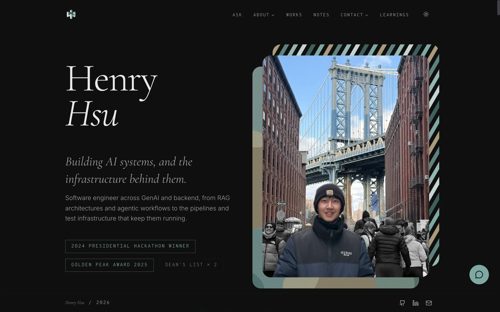

<div align="center">

<a href="https://www.yarikama.com">
  <picture>
    <source media="(prefers-color-scheme: dark)" srcset="docs/logo-dark.svg">
    
  </picture>
</a>

# Personal Website Front-End

[](https://github.com/yarikama/personal-website-front-end/actions/workflows/ci.yml)
[](https://www.yarikama.com)
[](https://vercel.com)
[](https://nodejs.org)
<br>
[](https://react.dev)
[](https://www.typescriptlang.org)
[](https://vite.dev)
[](https://tailwindcss.com)
[](https://vitest.dev)
[](https://github.com/yarikama/personal-website-front-end/commits/main)

</div>

The front end of [yarikama.com](https://www.yarikama.com), Henry Hsu's personal website. It shows the projects and notes, streams answers to visitors' questions about them from a self-hosted language model, and gives the author an editor with inline autocomplete from a second model.

It is a single-page app built with React 19, TypeScript, Vite and Tailwind CSS v4, and deployed on Vercel. The API, database and models live in [personal-website-back-end](https://github.com/yarikama/personal-website-back-end).

[](https://www.yarikama.com)

## What it does

- **Ask about my work**: answers stream in token by token, in any language, with numbered citations to the project, note or resume behind each claim. Highlight any passage on the site to ask about it.
- **Works**: projects by category, each with an animated cover and its own page, some with a written case study.
- **Notes**: Markdown essays with tables, KaTeX math and syntax highlighting.
- **Learnings**: a 3D knowledge graph to turn and zoom. Picking a topic lights up everything to learn before it, and each topic opens an interactive explainer.
- **Talks**: slide decks on a 16:9 canvas, with a presenter window that stays in step.
- **Admin**: editors for notes, projects and categories, inline autocomplete from a second self-hosted model, and the site's visitors, questions and messages.

[](https://www.yarikama.com/works)

## Quick start

Requires Node.js 22.

```bash
npm ci                # dependencies
cp .env.example .env  # points the site at a local back end on port 8080
npm run dev           # the site with hot reload on http://localhost:5173
```

To use production data instead, set `VITE_API_BASE_URL` in `.env` to `https://api.yarikama.com/api/v1`. More in [Development](docs/development.md).

## Documentation

| Doc | What's in it |
|---|---|
| [Features](docs/features.md) | Everything visitors can do, and what the author gets behind the login |
| [Architecture](docs/architecture.md) | How it reaches the API and images, tech stack, project layout |
| [Design notes](docs/design.md) | Streaming answers, untrusted model output, autocomplete, performance, accessibility, theme |
| [Development](docs/development.md) | Running locally, commands, CI and deployment |
